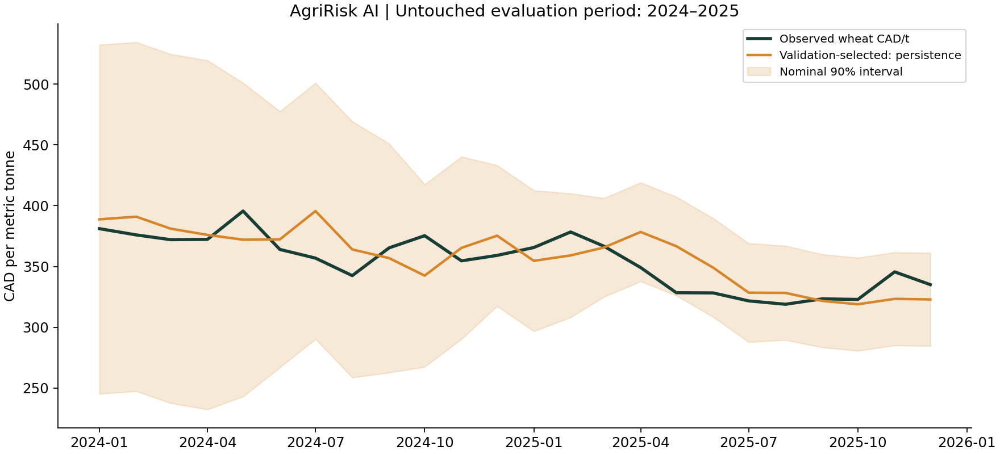

# AgriRisk AI

**Agricultural commodity forecasting and procurement risk for food manufacturers.**

A reproducible research prototype linking Food Science supply-chain decisions to financial machine learning. The worked case is a Canadian food processor buying USD-priced wheat. The dashboard translates price and currency shocks into purchasing costs, operating profit and margins.



## Research question

Do lagged exchange rates and related commodity prices improve monthly CAD-denominated wheat-cost forecasts beyond persistence and seasonal baselines, and do those improvements translate into smaller procurement-budget errors?

**Actual finding:** persistence won validation (2022–2023). Full-feature XGBoost had slightly lower test MAE (2024–2025), but was not the validation-selected model. See the technical report for paired uncertainty and the ablation study. The project does not assume AI must outperform simple forecasting.

## Quick start

Python 3.12 recommended. Run commands from this repository directory.

```bash
python -m venv .venv
source .venv/bin/activate
# Windows PowerShell: .venv\Scripts\Activate.ps1
python -m pip install -r requirements.txt
python -m agririsk.experiment
python -m pytest -q
streamlit run app.py
```

Open the local URL printed by Streamlit (normally http://localhost:8501). A network connection is required to install dependencies. Cached official source snapshots are included, so experiments run without downloading data again.

### Refresh sources deliberately

```bash
python -m agririsk.data --refresh
python -m agririsk.experiment
```

Refreshing changes the data vintage and may change results. Preserve the existing archive first. The research sample deliberately ends December 2025; this is not a live price terminal. URLs and SHA-256 hashes are recorded in `data/manifest.json`. Source layout/schema changes fail visibly instead of silently falling back to invented data.

## What is included

| Component | Location |
|---|---|
| Download, source validation and monthly transformation | `agririsk/data.py` |
| Seven model variants with lagged features | `agririsk/models.py` |
| Rolling experiments, intervals and block-bootstrap comparisons | `agririsk/experiment.py` |
| Cost/margin scenario engine | `agririsk/risk.py` |
| Interactive local dashboard | `app.py` |
| Complete technical report | `reports/TECHNICAL_REPORT.md` |
| Readable report with figures | `reports/technical_report.html` |
| Dataset definitions and rights | `docs/DATA_CARD.md` |
| Forecasts, metrics, ablations and business backtest | `reports/*.csv` |
| Leakage, accounting, data and dashboard tests | `tests/test_research.py` |
| Automated CI | `.github/workflows/tests.yml` |
| Five-minute walkthrough | `docs/DEMO.md` |

## Experimental design

- 108 monthly observations: January 2017–December 2025.
- Initial estimation begins in 2018 after feature warm-up; 2021 produces past-only calibration errors.
- Validation: 2022–2023. Final evaluation: 2024–2025. Models refit each month with expanding history; model choice stays fixed after validation.
- For target month t, both features and fitting labels stop at t−2, allowing for monthly publication delays. No random split, backward filling, or global scaling.
- Compare persistence, seasonal naive, three-month mean, standardized ridge, and three identical XGBoost configurations with different feature groups.
- Report MAE, RMSE, MAPE, nominal 90% interval coverage/width/score, paired bootstrap differences and business-budget errors.

This is a **current-vintage retrospective backtest**, not proof of historical live performance. Revisions may embed information unavailable at the forecast date. Intervals have no guaranteed coverage under structural breaks.

## Food Science relevance

Raw-material costs affect purchasing, ingredient sourcing, inventory planning and production margins. A food-science extension can combine these economics with validated yield, storage loss, quality specifications and shelf-life constraints. The current model does not infer contamination or justify unsafe ingredient substitution.

## Repository

Clone the repository:

```bash
git clone https://github.com/Abass69/AgriRisk.git
cd AgriRisk
```

Suggested description: “Reproducible wheat procurement forecasting, FX exposure and food-manufacturing margin stress tests.” Suggested topics: `food-science`, `time-series`, `xgboost`, `financial-risk`, `streamlit`, `agriculture`.

Code is MIT licensed. Source datasets retain their own terms and attribution; see `docs/DATA_CARD.md`. No World Bank or Bank of Canada endorsement is implied.
