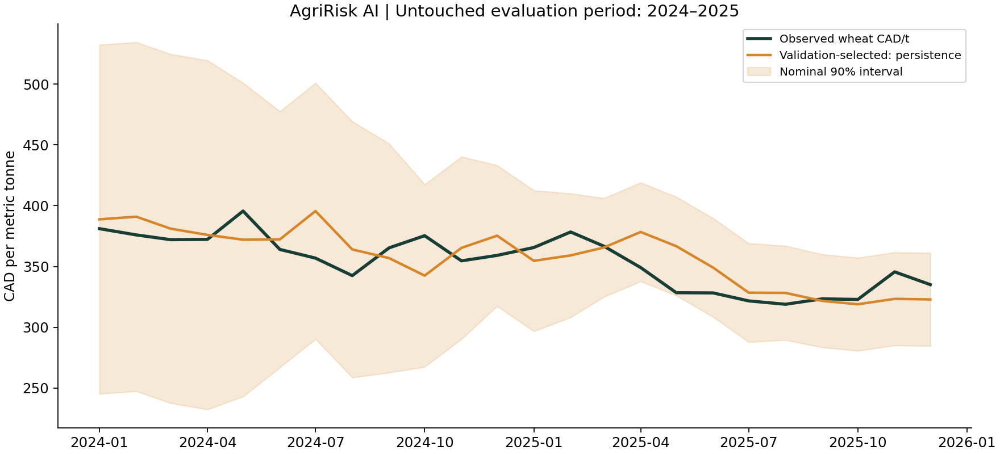
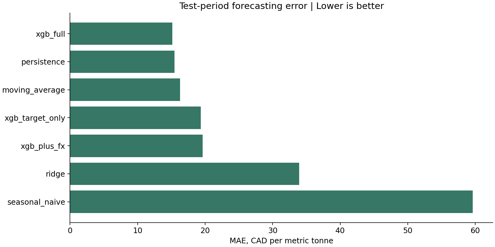

# AgriRisk AI — Technical Report

Commodity price and agricultural financial risk analysis

## Abstract

AgriRisk AI evaluates whether exchange-rate and related commodity information improves wheat procurement forecasts for a Canadian food manufacturer. The dataset contains 108 observed months from January 2017 through December 2025, combining World Bank wheat, maize and Brent prices with Bank of Canada USD/CAD observations. Seven forecasting variants are evaluated using expanding windows and a conservative publication-delay embargo.

The validation-selected model was persistence, with test MAE of CAD 15.47/t. Full-feature XGBoost achieved CAD 15.14/t on the same test months, but its paired difference from persistence was -0.33/t (approximate 95% interval -6.73 to 6.69). This does not establish superiority over persistence. A dashboard converts explicit price and currency shocks into purchasing costs and margins. Findings are retrospective, conditional on the source vintage, and not evidence of improved realised business profits.

## 1. Research question and Food Science connection

Primary question: Do lagged exchange rates and related commodity prices improve monthly CAD-denominated wheat-cost forecasts beyond simple historical baselines?

Secondary question: How do forecast errors and joint price/currency shocks translate into procurement-budget and operating-margin risk under fixed production assumptions?

Food Science connects through ingredient procurement, manufacturing yields, inventory losses, quality specifications and continuity of production. This first implementation models the purchasing-cost layer; it does not model food safety, spoilage, nutritional equivalence or optimal ingredient substitution. The selected case is a Canadian importer because the supplied FX source supports an internally consistent CAD/USD analysis. A Nigerian or other-country deployment needs local FX, tariffs, freight, supplier basis and firm-specific validation.

Hypotheses are that explicit FX features help a CAD cost model, and that adding wheat USD, maize and Brent context helps further. Graph features are not appropriate to this tabular time-series question. The ablation therefore removes groups of economic predictors, not transaction-network features.

## 2. Data, rights and preprocessing

Official source snapshots are retained with SHA-256 checksums and exact URLs in data/manifest.json. The World Bank workbook provides Wheat US HRW and Maize in USD/metric tonne and Brent in USD/barrel. Bank of Canada FXUSDCAD is CAD per USD. Daily FX is averaged within each month; the smallest month contains 19 observations. Calendar months are aligned without interpolation. The target is wheat_cad_t = wheat_usd_t × cad_per_usd. This product of monthly averages approximates benchmark purchasing exposure; it is not a daily transaction-weighted converted price.

The transformed study sample has 0 missing values. Non-numeric source markers are coerced to missing; missing or nonpositive/nonfinite values in the sample fail validation. No forward or backward imputation is applied. Lag construction creates expected warm-up missingness, and those training rows are dropped. No outlier deletion or winsorisation is performed because large movements are central to risk. Class imbalance is not applicable to continuous regression; rare shock regimes remain a sampling limitation.

The World Bank default dataset licence is CC BY 4.0 with additional terms and metadata/third-party exceptions. Bank of Canada data are used under its attribution-based permission to reproduce, subject to its exceptions and disclaimers; they are not labelled CC BY here. Full attribution and modifications are listed in docs/DATA_CARD.md, and original metadata are retained. Neither institution endorses this work. The code MIT licence does not replace data-source terms.

## 3. Forecast timing and validation design

Target t is the monthly average wheat cost for month t, with a planning decision at the beginning of t. Because the preceding month's commodity average may not yet have been published, every model is limited to observations through t−2. This is a two-step forecast from the latest included observation, not a one-step forecast with instantaneous monthly data. Both input features and training target labels for t−1 are embargoed.

Features begin after a 13-month warm-up. Initial model estimation uses available 2018–2020 history. Rolling forecasts during 2021 form calibration errors; 2022–2023 provides 24 validation months; 2024–2025 provides 24 final evaluation months. Every month uses an expanding training window. During test evaluation, newly available older test outcomes may enter the training/calibration window, as in a rolling operational process, but model choice and hyperparameters are not reselected on test results. The validation rule is lowest MAE.

StandardScaler for ridge is fitted inside each training window. XGBoost needs no scaling. Features for each series are lags 2, 3, 4, 7 and 13, a three-observation rolling mean ending t−2, and six-observation volatility of percentage returns ending t−2. Month sine/cosine terms are known in advance. No contemporaneous target-month market input is used.

The dataset was downloaded as a revised snapshot rather than from historical release vintages. Publication-delay controls prevent ordinary look-ahead in the code, but cannot eliminate revision-based hindsight. A true real-time evaluation requires archived releases and their actual publication timestamps.

## 4. Models and controlled ablations

Persistence predicts the most recent available CAD wheat price, y[t−2]. Seasonal naive predicts y[t−12]. The moving average uses y[t−4], y[t−3], y[t−2]. Ridge uses all features with alpha=10 and training-only standardisation.

XGBoost uses 80 trees, depth 2, learning rate 0.04, minimum child weight 5, L2 regularisation 10, full row/column sampling, square-error loss and seed 42. These are fixed compact research settings, not an optimised search. Target-only uses CAD wheat history and calendar terms. Plus-FX adds CAD/USD history. Full adds USD wheat, maize and Brent histories. Identical training windows and model settings isolate the predictive contribution of feature groups.

Past CAD wheat prices already contain historical FX effects. Consequently, the first ablation tests explicit FX information beyond the combined target, not whether exchange rates matter economically. The full block adds several related inputs together; it cannot establish which individual economic variable causes a change in accuracy. Further individual-variable and multi-seed ablations are future work.

## 5. Executed forecasting results

| split | model | MAE | RMSE | MAPE_pct | coverage90 | interval_width |
| --- | --- | --- | --- | --- | --- | --- |
| test | moving_average | 16.309 | 19.983 | 4.655 | 1.0 | 168.425 |
| test | persistence | 15.474 | 18.851 | 4.373 | 1.0 | 152.0 |
| test | ridge | 33.915 | 43.24 | 9.371 | 1.0 | 240.093 |
| test | seasonal_naive | 59.636 | 74.846 | 16.575 | 1.0 | 402.709 |
| test | xgb_full | 15.144 | 19.574 | 4.361 | 0.875 | 166.088 |
| test | xgb_plus_fx | 19.623 | 24.226 | 5.645 | 1.0 | 181.032 |
| test | xgb_target_only | 19.381 | 24.151 | 5.602 | 1.0 | 200.515 |
| validation | moving_average | 59.462 | 74.112 | 11.427 | 0.875 | 262.151 |
| validation | persistence | 51.409 | 69.16 | 9.77 | 0.875 | 259.137 |
| validation | ridge | 71.368 | 94.946 | 13.665 | 0.833 | 297.483 |
| validation | seasonal_naive | 138.016 | 157.108 | 26.858 | 0.875 | 507.646 |
| validation | xgb_full | 62.168 | 90.601 | 11.246 | 0.875 | 399.376 |
| validation | xgb_plus_fx | 65.175 | 92.398 | 11.943 | 0.875 | 405.224 |
| validation | xgb_target_only | 68.376 | 94.904 | 12.643 | 0.875 | 390.199 |

## Result interpretation

Errors are in CAD per metric tonne except MAPE (percent) and coverage (fraction). Persistence was chosen using validation MAE 51.41; XGBoost full had validation MAE 62.17. Although XGBoost full had the smallest observed test MAE, replacing the selected model after seeing the test would compromise the selection procedure.

For persistence, the approximate 95% block-bootstrap interval for test MAE is 11.50–19.76 CAD/t. At 1,000 tonnes, its average absolute benchmark procurement-budget error is about CAD 15,474. With fixed CAD 600,000 revenue, that corresponds to an average absolute margin-estimation error of 2.58 percentage points. This is an accounting translation of benchmark price error, not an independent validation against actual company costs.

## 6. Ablation results and paired uncertainty

| split | comparison | MAE_delta | CI_low | CI_high |
| --- | --- | --- | --- | --- |
| validation | xgb_plus_fx minus xgb_target_only | -3.201 | -8.596 | 1.485 |
| validation | xgb_full minus xgb_plus_fx | -3.007 | -7.149 | 0.323 |
| validation | xgb_full minus xgb_target_only | -6.208 | -14.79 | 0.626 |
| validation | xgb_full minus persistence | 10.759 | -19.467 | 45.4 |
| test | xgb_plus_fx minus xgb_target_only | 0.242 | -2.584 | 3.466 |
| test | xgb_full minus xgb_plus_fx | -4.48 | -7.599 | -1.942 |
| test | xgb_full minus xgb_target_only | -4.238 | -8.893 | -1.105 |
| test | xgb_full minus persistence | -0.331 | -6.727 | 6.694 |

## Ablation interpretation

Negative MAE differences favour the first model. Explicit FX alone did not reliably help: the uncertainty interval crosses zero in both periods. Adding the full economic block reduced test error relative to both reduced XGBoost variants, with exploratory intervals below zero. However, full XGBoost versus persistence has an interval crossing zero. This is evidence for useful added context within this particular tree model, not broad evidence that AI beats a naive forecasting baseline.

Intervals use 2,000 paired circular moving-block bootstrap replicates with a fixed seed and three-month blocks. Six-month sensitivity results are also saved in ablations.csv. Resampling paired month-level loss differences preserves comparison alignment and some serial dependence. With only 24 months per evaluation period, estimates are unstable. Multiple comparisons are exploratory and not adjusted for multiplicity; no confirmatory significance claim is made.

## 7. Predictive uncertainty and shocks

A nominal 90% interval uses the finite-sample adjusted 90th percentile of the latest up to 24 available absolute rolling forecast errors, requiring at least 10. For target t, only errors for targets through t−2 enter calibration. Lower prices are clipped at zero. These are adaptive residual intervals inspired by conformal calibration; time dependence and nonstationarity mean there is no distribution-free coverage guarantee.

Report coverage, mean width and interval score together. The 90% interval score is width plus 20 times the distance of an actual outside the interval. Persistence covered all 24 test observations, but its average interval width was approximately CAD 152/t: high coverage came with broad uncertainty, partly inherited from more volatile earlier periods. Full XGBoost coverage was 87.5%; a 24-month sample is too small to assess nominal calibration precisely.

The selected-model test backtest labels a large move as an absolute change of at least 10% from the t−2 CAD benchmark. Only one test month qualifies, with absolute error about CAD 38.24/t versus CAD 14.48/t over the other 23 months. This small subgroup cannot establish shock robustness. The larger validation errors demonstrate substantial regime sensitivity. Imposed dashboard shocks have no assigned probability and cannot be scored as forecasts.

## 8. Business scenario and sensitivity

Material cost = Q × P × E × (1+sP) × (1+sE), where Q is tonnes, P is wheat USD/t, E is CAD/USD and sP/sE are user-specified fractional changes. Total operating cost adds Q × freight CAD/t plus other operating costs. Profit is revenue less total cost. Margin is 100 × profit/revenue. Financing, tax, tariffs, hedging, quality premiums and demand responses are excluded.

Illustration: 1,000 tonnes at USD 300/t and CAD 1.35/USD gives CAD 405,000 materials. With CAD 30/t freight, CAD 120,000 other costs and CAD 600,000 sales, profit is CAD 45,000 and margin 7.5%. A 20% wheat increase and 10% rise in CAD/USD jointly increase materials by 32% to CAD 534,600, leaving a CAD 84,600 loss and −14.1% margin. The interaction term explains why 20% plus 10% is not merely 30%.

Holding other inputs fixed, material cost has unit elasticity to wheat price and FX separately. Its derivatives are Q×E with respect to P and Q×P with respect to E. The dashboard sensitivity grid makes the joint interaction visible. Scenario arithmetic is checked automatically. A farmer receiving USD-linked revenue could have a different exposure direction; the importer model must not be reused unchanged for a producer.

## 9. Operational prototype and reproducibility

The Streamlit dashboard supports editable input prices, FX, volume, revenue, freight and other costs; interactive price/FX shocks; a margin sensitivity table; downloadable scenario grids; historical forecast plots; metric and ablation tables; and downloadable predictions. It is a local research demonstration, not a hosted production service or a live market feed.

Run python -m agririsk.experiment to regenerate processed data, rolling forecasts, tables, charts and this report from cached official files. Run python -m pytest -q to check accounting identities, invalid inputs, monthly integrity, feature timing, prediction invariance to future/unavailable data, delayed interval calibration and dashboard execution. The GitHub Actions workflow reproduces experiments and executes the tests. The included dependency versions and manifest support auditability; no external credentials are needed for the dataset sources.

The implementation was executed in the supplied environment. The source repository includes installation instructions in README.md and a short research presentation guide in docs/DEMO.md.

## 10. Limitations, ethics and next research

The sample covers one wheat benchmark, one currency pair and 108 months, with only 24 final test targets. Results do not generalise automatically across countries, crops, farmers or manufacturers. Current-vintage revisions, benchmark basis risk, unobserved contracts and monthly aggregation restrict operational interpretation. Oil is an economic context proxy, not a complete model of inflation, interest rates, monetary policy or geopolitical shocks. Feature relationships are predictive, not causal.

No private personal or firm data are used. Before operational deployment, protect supplier contracts and purchasing volumes, obtain appropriate permission for private records, and audit performance across small and large enterprises. Do not use price projections as evidence of food safety or as a reason to substitute ingredients without scientific and regulatory checks. Avoid presenting uncertain forecasts as guaranteed savings or institutional endorsements.

Priority extensions: (1) archived release vintages and longer harmonised FX histories; (2) additional crops, countries and genuine firm invoices; (3) isolated-variable ablations and nested time-series tuning; (4) macroeconomic inputs with release calendars; (5) multi-horizon forecasts and joint price/FX distributions; (6) prospective evaluation of procurement budgets; (7) inventory models with yield, shelf-life and spoilage constraints; and (8) hedging and cash-flow models only after adding contract and financing data.

## References

World Bank Commodity Markets: https://www.worldbank.org/en/research/commodity-markets
World Bank dataset terms: https://www.worldbank.org/ext/en/legal/terms-conditions/datasets
World Bank data licensing: https://datacatalog.worldbank.org/public-licenses
Bank of Canada Valet: https://www.bankofcanada.ca/valet/docs/
Bank of Canada terms: https://www.bankofcanada.ca/terms/
Bank of Canada exchange-rate definitions: https://www.bankofcanada.ca/rates/exchange/daily-exchange-rates/
Exact source download URLs and hashes: data/manifest.json. Full data transformations and source acknowledgements: docs/DATA_CARD.md.